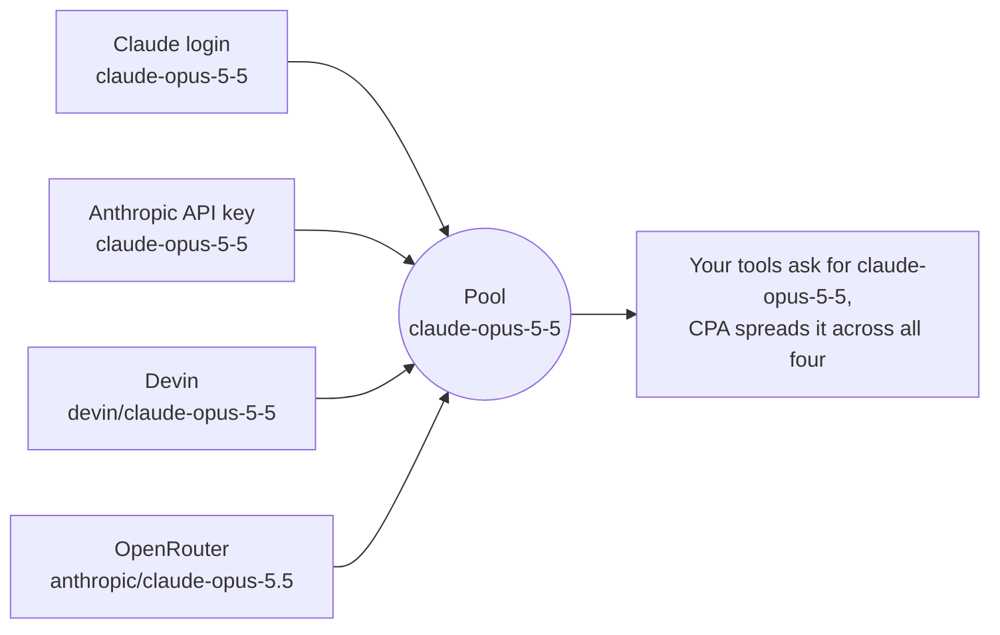

<div align="center">


# Pools and Aliases for CLIProxyAPI

**One model, every subscription.** Pool every account and API key that serves the same model under its plain model id.

[](https://github.com/ngvoicu/cpa-pools-and-aliases/releases/latest)
[](https://github.com/ngvoicu/cpa-pools-and-aliases/actions/workflows/build.yml)
[](LICENSE)
[](https://github.com/router-for-me/CLIProxyAPI)

[Read the article](https://ngvoicu.dev/articles/cliproxyapi-model-pools/) ·
[Download](https://github.com/ngvoicu/cpa-pools-and-aliases/releases/latest) ·
[CLIProxyAPI](https://github.com/router-for-me/CLIProxyAPI)


</div>

## Why

[CLIProxyAPI](https://github.com/router-for-me/CLIProxyAPI) (CPA) runs on your machine and serves your AI
subscriptions (Claude Code, ChatGPT Codex, Antigravity, Grok Build, Muse Code, Devin and others) and API keys as
one local API in the OpenAI, Claude and Gemini formats. Any tool can then use them: Claude Code, Codex, pi, your own
scripts.

CPA spreads requests across every account that serves a model **under the same name**. The catch: every provider
names the same model differently.



CPA has aliases to fix that, but they live in three places (each login's credential file, each API key's model
list, a global section per provider), and editing them by hand goes wrong fast. This plugin gives you one page
for it: pick a model, and every account and key that offers it joins.

The full story, with screenshots: **[Pools for CLIProxyAPI](https://ngvoicu.dev/articles/cliproxyapi-model-pools/)**.

## What you get


- **One model per pool.** A pool's name is the model's own id, so your tools price it, size its context and offer
  its reasoning levels as that model. Failover moves to another member, never to another model.
- **Matching across providers.** The vendor prefix, case and punctuation are ignored: `devin/gpt-6-1-sol` and
  `gpt-6.1-sol` land in the same pool. Dropping a different model on a pool is refused.
- **New accounts join on their own.** Add an account or key, open the page, and it is already in the pools for its
  models, ready to save. Remove a member and it stays out.
- **Clean model lists.** In every list CPA serves (OpenAI, Claude, Gemini and Codex-style clients such as pi) a pool
  shows as its plain id, never as `Claude Opus 5.5 (Devin)`.
- **Pools only.** One switch hides every model that isn't in a pool from model lists. Requests by name still work.
- **Switch to…** moves a whole pool to a new model version in one save.
- **Cache levels.** Each member shows how long it keeps the prompt cache, and each pool shows a summary such as
  "cache: 5 min – 1 hour (mixed)". Members that don't cache are flagged and can be left out with one click.
- **Limits.** Each member shows its context window and output limit, each pool the smallest of them. Members with
  lower limits than the rest are flagged and can be left out with one click.
- **Review before save.** Every save lists the exact changes, account by account.
- **Nothing in the request path.** Pools are saved as CPA's own aliases. Remove the plugin and your pools keep working.

## Quick start

Requires CPA 8 with plugins enabled (tested on 8.0.50 and 8.0.53).

1. **Install.** Console → **Plugin Store** → *Pools and Aliases* → Install. Or download the zip for your system from
   [Releases](https://github.com/ngvoicu/cpa-pools-and-aliases/releases/latest) and put the library inside it into
   your plugins folder.
2. **Enable** it in the CPA config and restart CPA once:

   ```yaml
   plugins:
     enabled: true
     dir: "~/.cli-proxy-api/plugins"
     configs:
       cpa-pools-and-aliases:
         enabled: true
   ```

3. **Open** *Plugins → Pools and Aliases* in the console (or `http://<cpa>/v0/resource/plugins/cpa-pools-and-aliases/ui`).
4. **Create a pool:** pick a model at the top, press *Create pool*, review, save. CPA applies it without a restart.

Your tools don't change: they keep asking for `claude-opus-5-5`, and CPA now spreads those requests across the pool.

## How it works

Members that already serve the exact model id are in the pool automatically (shown as *direct*); the others get an
alias `<their model> → <pool id>`. The plugin itself only renders the page and cleans model-list display names.

| What | Saved to | Management API |
|---|---|---|
| Account member (OAuth login) | `model_aliases` in that credential's JSON file | `PATCH /v8/management/credentials/fields` |
| API-key member | `api-keys.<provider>[group](.keys[i]).models[]` | `PUT /v8/management/config/api-keys/<provider>` |
| Pool list | `plugins.configs.cpa-pools-and-aliases.pools` (model ids) | `PUT /v8/management/config/plugins/configs/cpa-pools-and-aliases/pools` |
| Removed members | `plugins.configs.cpa-pools-and-aliases.skip` | same, `/skip` |
| Cache levels you set | `plugins.configs.cpa-pools-and-aliases.cache` (pool → member → level) | same, `/cache` |
| *Pools only* | `plugins.configs.cpa-pools-and-aliases.pools-only` | same, `/pools-only` |

Aliases for names that aren't pools are never shown or changed. Deleting a pool removes only the aliases it
created; accounts that serve the model directly keep serving it.

### Cache levels

A prompt cache belongs to the account that served the request. Session affinity keeps a conversation on one member,
so it gets that member's cache; a conversation that moves to another member starts cold.

- **Claude members are known:** logins get a 1-hour cache from CPA, API keys Anthropic's 5-minute default (1 hour on
  keys with the `claude-code-cli` fingerprint profile).
- **Every other member** (Devin, Codex, OpenAI-compatible keys, ...) depends on the provider and the model, so you set it
  per pool member: *no cache*, *5 min*, *30 min*, *1 hour* or *longer*, for example from
  [cache-ttl-probe](https://github.com/ngvoicu/cache-ttl-probe) measurements.
- The pool summary shows the shortest and longest level. Mixed pools work; clients that refresh caches (pi) just have
  to plan for the shortest.
- **No cache** marks a member whose conversations pay the full price on every message (for example Claude through an
  OpenAI-compatible OpenRouter entry, which gets no cache markers). The member is highlighted, the review warns about
  it, *Leave out* removes it, and it doesn't rejoin automatically.

The levels are information for you: the plugin doesn't change any request.

### Limits

Each member shows its **context window / output limit**, from CPA's model catalog for its provider (for example
Codex `gpt-6.1-sol` 272k / 128k, Devin 1M / 64k). `max-context-length` on a key's model in CPA's config overrides the
window. OpenAI-compatible members have no catalog entry and show *limits unknown*.

- The pool shows the **smallest** known values: every member can handle a request that fits them.
- Differences under 10% (1.01M next to 1.05M) aren't flagged.
- CPA tells clients the limits of **one** member per pool (whichever it registered last), not the smallest. When members
  differ, a long conversation can fail, or a reply end early, when it lands on a member with lower limits. Those
  members are highlighted with *Leave out*; leaving them out makes the pool's limits consistent.

Like cache levels, limits are shown only: nothing is stored and no request changes.

### Good to know

- **API keys without a model list** serve every default model of their provider. Adding a pool member writes those
  defaults into the list so the key keeps serving them; the review tells you.
- **Direct members can't be removed here**, because CPA includes them automatically. Exclude the model on that
  account in CPA instead.
- **Prompt caches belong to accounts.** A request that moves to another member starts cold; turn on CPA's session
  affinity so a conversation stays on one account.
- **The management key.** The page uses the normal `/v8/management` API. If you saved your key in the console
  (*Remember password*) the page reuses it; otherwise it asks once and keeps it in the tab (or on the device if you
  choose). The page is a static resource with no secrets; every write needs the key.

## Development

Rust (stable). The page in `web/index.html` is embedded into the library at compile time.

```bash
make build      # dist/cpa-pools-and-aliases.{dylib,so,dll}
make test
make install PLUGINS_DIR=~/.cli-proxy-api/plugins
make package TARGET=aarch64-apple-darwin GOOS=darwin GOARCH=arm64   # release zip
```

After `make install`, restart CPA. To update a running CPA **without a restart** (a restart drops session affinity,
and with it your prompt caches), install a versioned copy and pin it; CPA hot-reloads the plugin:

```bash
cp dist/cpa-pools-and-aliases.dylib ~/.cli-proxy-api/plugins/cpa-pools-and-aliases-v1.0.1.dylib
# CPA config:  plugins.configs.cpa-pools-and-aliases.version: "1.0.1"
```

### Release

1. Bump `version` in `Cargo.toml`, add a `CHANGELOG.md` entry, commit.
2. `git tag v1.0.1 && git push --tags`

Every push runs the tests; a `v*` tag builds darwin arm64/amd64, linux amd64/arm64 and windows amd64 and publishes
the release in the layout the CPA plugin store expects (`<id>_<version>_<goos>_<goarch>.zip` with the library at the
root, plus `checksums.txt`). The store reads the latest release, so new versions need no store change; the entry
itself is in [`store/registry-entry.json`](store/registry-entry.json).

## License

[MIT](LICENSE) · Made by [Gabriel Voicu](https://ngvoicu.dev)
