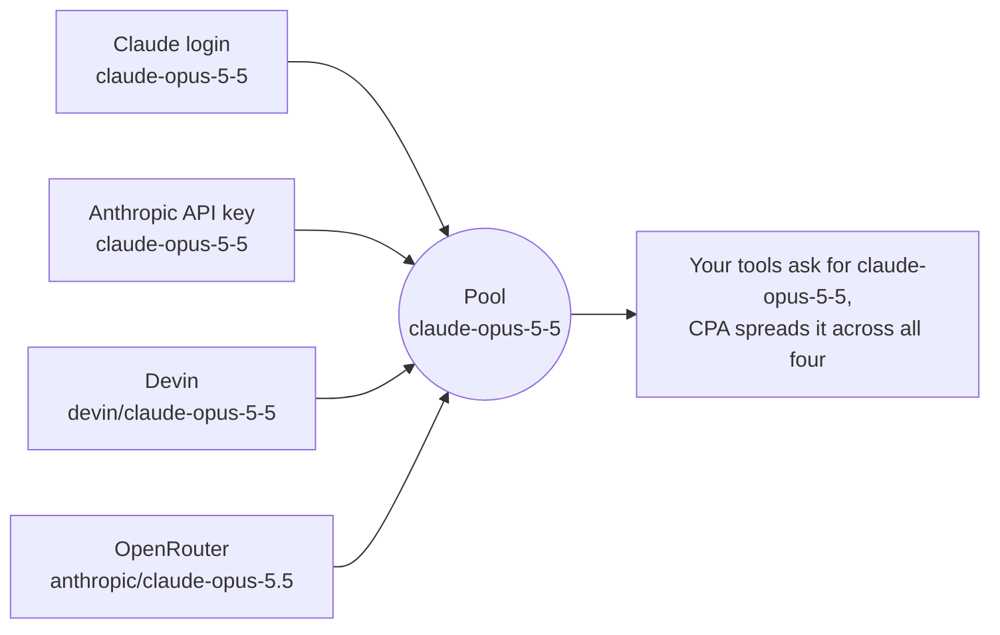
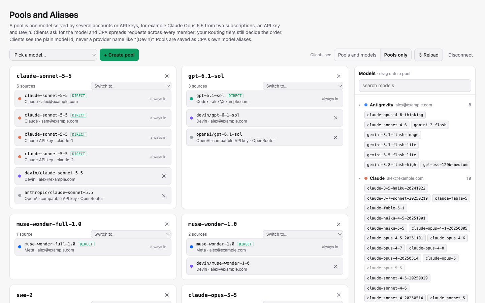

<div align="center">


# Pools and Aliases for CLIProxyAPI

**One model, every subscription.** Pool every account and API key that serves the same model under its plain model id.

[](https://github.com/ngvoicu/cpa-pools-and-aliases/releases/latest)
[](https://github.com/ngvoicu/cpa-pools-and-aliases/actions/workflows/build.yml)
[](LICENSE)
[](https://github.com/router-for-me/CLIProxyAPI)

[Read the article](https://ngvoicu.dev/articles/cliproxyapi-model-pools/) ·
[Download](https://github.com/ngvoicu/cpa-pools-and-aliases/releases/latest) ·
[CLIProxyAPI](https://github.com/router-for-me/CLIProxyAPI)


</div>

## Why

[CLIProxyAPI](https://github.com/router-for-me/CLIProxyAPI) (CPA) runs on your machine and serves your AI
subscriptions (Claude Code, ChatGPT Codex, Antigravity, Grok Build, Muse Code, Devin and others) and API keys as
one local API in the OpenAI, Claude and Gemini formats. Any tool can then use them: Claude Code, Codex, pi, your own
scripts.

CPA spreads requests across every account that serves a model **under the same name**. The catch: every provider
names the same model differently.



CPA has aliases to fix that, but they live in three places (each login's credential file, each API key's model
list, a global section per provider), and editing them by hand goes wrong fast. This plugin gives you one page
for it: pick a model, and every account and key that offers it joins.

The full story, with screenshots: **[Pools for CLIProxyAPI](https://ngvoicu.dev/articles/cliproxyapi-model-pools/)**.

## What you get



- **One model per pool.** A pool's name is the model's own id, so your tools price it, size its context and offer
  its reasoning levels as that model. Failover moves to another member, never to another model.
- **Extra pools for the same model.** Give a pool a name and it becomes `<name>/<model>`, e.g. `subs/claude-opus-5-5`
  with only your Claude logins next to the main `claude-opus-5-5`. Clients pick one by name; pi and the page still read
  it as the model. Any account or key can be in several pools The name can be changed later in the field next to the pool title
  (empty = main pool).
- **Matching across providers.** The vendor prefix, case and punctuation are ignored: `devin/gpt-6-1-sol` and
  `gpt-6.1-sol` land in the same pool. Dropping a different model on a pool is refused.
- **New accounts join on their own.** Add an account or key, open the page, and it is already in the pools for its
  models, ready to save. Remove a member and it stays out. Extra pools keep the members you pick.
- **Remove any member.** Members that serve the exact id (*direct*) can be removed too: an API key drops the model
  from its list, an account keeps it only through its extra-pool aliases, or gets it excluded. *+ Add* undoes it.
- **Clean model lists.** In every list CPA serves (OpenAI, Claude, Gemini and Codex-style clients such as pi) a pool
  shows as its plain id, never as `Claude Opus 5.5 (Devin)`.
- **Pools only.** One switch hides every model that isn't in a pool from model lists. Requests by name still work.
- **Switch to…** moves a whole pool to a new model version in one save.
- **Cache levels.** Each member shows how long it keeps the prompt cache, and each pool shows a summary such as
  "cache: 5 min – 1 hour (mixed)". Members that don't cache are flagged and can be left out with one click.
- **Limits.** Each member shows its context window and output limit, each pool the smallest of them. Members with
  lower limits than the rest are flagged and can be left out with one click.
- **Consistent limits for clients.** Model lists report each pool's smallest limits, and its cache lifetime when every
  member caches, so clients such as pi size and warm conversations correctly whichever member CPA registered last.
  When a catalog changes, opening the page updates the stored limits on its own.
- **Cache hit rates.** Each pool and member shows how much of the prompt was read from the cache, for the last hour and
  the last day, from CPA's own records of the requests it served. A member with a low rate is highlighted.
- **Review before save.** Every save lists the exact changes, account by account.
- **Nothing in the request path.** Pools are saved as CPA's own aliases. Remove the plugin and your pools keep working.

## Quick start

Requires CPA 8 with plugins enabled (tested on 8.0.50 and 8.0.53).

1. **Install.** Console → **Plugin Store** → *Pools and Aliases* → Install. Or download the zip for your system from
   [Releases](https://github.com/ngvoicu/cpa-pools-and-aliases/releases/latest) and put the library inside it into
   your plugins folder.
2. **Enable** it in the CPA config and restart CPA once:

   ```yaml
   plugins:
     enabled: true
     dir: "~/.cli-proxy-api/plugins"
     configs:
       cpa-pools-and-aliases:
         enabled: true
   ```

3. **Open** *Plugins → Pools and Aliases* in the console (or `http://<cpa>/v0/resource/plugins/cpa-pools-and-aliases/ui`).
4. **Create a pool:** search for a model at the top (by model, account or provider; newest first, with the accounts and
   keys that serve it), press *Create pool*, review, save. CPA applies it without a restart.

Your tools don't change: they keep asking for `claude-opus-5-5`, and CPA now spreads those requests across the pool.

## How it works

Members that already serve the exact model id are in the model's main pool automatically (shown as *direct*); the
others get an alias `<their model> → <pool id>`. Extra pools (`<name>/<model>`) are aliases only. The plugin itself
renders the page and rewrites pool entries in model lists (plain display name, limits, cache lifetime).

| What | Saved to | Management API |
|---|---|---|
| Account member (OAuth login) | `model_aliases` in that credential's JSON file | `PATCH /v8/management/credentials/fields` |
| API-key member | `api-keys.<provider>[group](.keys[i]).models[]` | `PUT /v8/management/config/api-keys/<provider>` |
| Pool list | `plugins.configs.cpa-pools-and-aliases.pools` (model ids) | `PUT /v8/management/config/plugins/configs/cpa-pools-and-aliases/pools` |
| Removed members | `plugins.configs.cpa-pools-and-aliases.skip` | same, `/skip` |
| Cache levels you set | `plugins.configs.cpa-pools-and-aliases.cache` (pool → member → level) | same, `/cache` |
| Limits reported to clients | `plugins.configs.cpa-pools-and-aliases.limits` (pool → `context`, `output`, `cache-ttl`) | same, `/limits` |
| Removed direct member (account) | `excluded_models` in its credential file, or `fork: false` on its extra-pool aliases | `PATCH …/credentials/fields` |
| *Pools only* | `plugins.configs.cpa-pools-and-aliases.pools-only` | same, `/pools-only` |
| Where cache-hit counts are kept (optional, set by hand) | `plugins.configs.cpa-pools-and-aliases.stats-file` | – |

Aliases for names that aren't pools are never shown or changed. Deleting a pool removes only the aliases it
created; accounts that serve the model directly keep serving it.

### Cache levels

A prompt cache belongs to the account that served the request. Session affinity keeps a conversation on one member,
so it gets that member's cache; a conversation that moves to another member starts cold.

- **Claude members are known:** logins get a 1-hour cache from CPA, API keys Anthropic's 5-minute default (1 hour on
  keys with the `claude-code-cli` fingerprint profile).
- **Every other member** (Devin, Codex, OpenAI-compatible keys, ...) depends on the provider and the model, so you set it
  per pool member: *no cache*, *5 min*, *30 min*, *1 hour* or *2 hours*, for example from
  [cache-ttl-probe](https://github.com/ngvoicu/cache-ttl-probe) measurements. *2 hours* fits routes whose cache is
  measured to last hours (e.g. GPT-6.1 Sol on a ChatGPT/Codex login); nothing longer is offered, because past ~2 hours
  the cache is a coin flip on every route measured. The *longer* level of earlier versions is read as *1 hour* (what
  clients were already told) and saved that way on the next save.
- The pool summary shows the shortest and longest level. Mixed pools work; clients that refresh caches (pi) just have
  to plan for the shortest.
- **No cache** marks a member whose conversations pay the full price on every message (for example Claude through an
  OpenAI-compatible OpenRouter entry, which gets no cache markers). The member is highlighted, the review warns about
  it, *Leave out* removes it, and it doesn't rejoin automatically.

Members without a level get a **suggestion** with one-click *Use*:

1. **Measured, when there is a measurement.** [`observed.json`](https://github.com/ngvoicu/cache-ttl-probe/blob/main/observed.json)
   holds public measurements of how long each route really keeps a cache. A run on the same route and model, made
   through CPA, decides: the level at or below the longest wait at which every check still found the cache. Routes
   covered: Codex, Devin, Meta and Antigravity logins, OpenRouter entries, OpenAI API keys. A vendor's documented
   lifetime often doesn't hold on a reseller: GPT-6 Astra is documented at 30 minutes and measured at 5 through Devin.
2. **Documented, otherwise** (models.dev). On OpenRouter entries CPA marks requests for caching (since
   router-for-me/CLIProxyAPI#7284), so they keep the model's documented lifetime. Other OpenAI-compatible entries get
   no cache markers, so models that only cache on request (Claude) are suggested *no cache* there, while models that
   cache automatically keep their documented lifetime.

A level you set **above** the measured one is flagged (`set to 30 min; measured: 5 min`) with *Use*; hover for the
run behind it. Suggestions count only once you accept them. To add measurements for your own routes, see
[cache-ttl-probe](https://github.com/ngvoicu/cache-ttl-probe).

The levels are information for you: the plugin doesn't change any request.

### Limits

Each member shows its **context window / output limit**, from CPA's model catalog for its provider (for example
Codex `gpt-6.1-sol` 272k / 128k, Devin 1M / 64k). `max-context-length` on a key's model in CPA's config overrides the
window. Members CPA has no data for (OpenAI-compatible entries) fall back to **OpenRouter's model list** (for OpenRouter
entries) and **models.dev** (smaller value of each when both have it, e.g. GPT-6.1 Sol 922k input, not the 1.05M total),
marked with their source. Only members found nowhere show *limits unknown*. The page fetches both lists in the
background and keeps a compact extract in the browser for a day.

- The pool shows the **smallest** known values: every member can handle a request that fits them.
- Differences under 10% (1.01M next to 1.05M) aren't flagged.
- CPA on its own tells clients the limits of **one** member per pool (whichever it registered last). Saving stores each
  pool's smallest limits, and the plugin writes them into every model list (Codex-style `context_window`,
  `max_context_window`, `max_tokens`; Gemini `inputTokenLimit`, `outputTokenLimit`), so they no longer change with
  registration order. Members with lower limits are highlighted with *Leave out*, or move the others to an extra pool.
- **Stored limits follow the catalogs.** When the page opens and has every source of limits (CPA's catalogs, then
  OpenRouter's list and models.dev in the background), stored limits that no longer match are saved on their own and a
  note lists what changed (e.g. `gpt-6-sol output 64k → 128k`). If anything else is pending, they wait for *Save*.
- **Cache lifetime:** when every member's cache level is known and none is *no cache*, Codex-style lists also carry
  `prompt_cache_ttl_seconds` (the shortest level). pi's CPA extension uses it instead of
  its catalog value, so a pool of Claude logins (1 hour) isn't refreshed every few minutes.

No request changes: the limits are what clients are told.

### Cache hit rates

CPA hands every finished request to the plugin with its token counts. For requests to a pool the plugin adds up, per
member, the prompt tokens and how many of them were read from the cache, in 5-minute slots kept for a day. The page
shows the **last hour** (or the last day when the last hour had none) on every member and both on the pool, and
refreshes them every minute. Until a window is complete it is labelled by its start (`since 23:12`) instead of "last
hour" or "last 24 h". The tooltip has the requests, failures and tokens read and written.

**Keeping the counts across restarts.** By default the counts live in memory and start again when CPA or the plugin
restarts. To keep them, name a file in the plugin's config:

```yaml
plugins:
  configs:
    cpa-pools-and-aliases:
      stats-file: "~/.cpa-pools-and-aliases/cache-stats.json"
```

The plugin reads the file when it starts, and writes it at most once a minute while requests arrive and once more when
it stops (written to a temporary file and renamed; owner-only on Unix). It holds the same numbers as the page: pool,
member, token counts. Use an absolute path or `~/`. **Don't put it inside CPA's auth directory** (that includes the
default plugins folder under it): CPA loads every `.json` there as a credential. If the file can't be written, the
pool line says "counts not saved" and the tooltip gives the reason.

- Providers count input two ways (Anthropic's excludes the cached part, OpenAI's includes it); the plugin reads each
  the right way, so rates compare across members.
- The first message of every conversation is a miss, so even a perfect cache stays below 100%. A low rate on a busy
  member means its cache expires between messages (check its cache level, or warm it from the client).
- The counts are served at `GET /v0/management/cpa-pools-and-aliases/cache-stats` (management key), never with any
  key or prompt.

### Good to know

- **API keys without a model list** serve every default model of their provider. Adding a pool member writes those
  defaults into the list so the key keeps serving them; the review tells you.
- **Removing a direct member** makes that account or key stop serving the model under its own name (it is the pool's
  id). An account that is also in an extra pool keeps serving it there. Deleting or switching a pool never hides
  anything.
- **Prompt caches belong to accounts.** A request that moves to another member starts cold; turn on CPA's session
  affinity so a conversation stays on one account.
- **The management key.** The page uses the normal `/v8/management` API. If you saved your key in the console
  (*Remember password*) the page reuses it; otherwise it asks once and keeps it in the tab (or on the device if you
  choose). The page is a static resource with no secrets; every write needs the key.

## Development

Rust (stable). The page in `web/index.html` is embedded into the library at compile time.

```bash
make build      # dist/cpa-pools-and-aliases.{dylib,so,dll}
make test
make install PLUGINS_DIR=~/.cli-proxy-api/plugins
make package TARGET=aarch64-apple-darwin GOOS=darwin GOARCH=arm64   # release zip
```

After `make install`, restart CPA. To update a running CPA **without a restart** (a restart drops session affinity,
and with it your prompt caches), install a versioned copy and pin it; CPA hot-reloads the plugin:

```bash
cp dist/cpa-pools-and-aliases.dylib ~/.cli-proxy-api/plugins/cpa-pools-and-aliases-v1.0.1.dylib
# CPA config:  plugins.configs.cpa-pools-and-aliases.version: "1.0.1"
```

### Release

1. Bump `version` in `Cargo.toml`, add a `CHANGELOG.md` entry, commit.
2. `git tag v1.0.1 && git push --tags`

Every push runs the tests; a `v*` tag builds darwin arm64/amd64, linux amd64/arm64 and windows amd64 and publishes
the release in the layout the CPA plugin store expects (`<id>_<version>_<goos>_<goarch>.zip` with the library at the
root, plus `checksums.txt`). The store reads the latest release, so new versions need no store change; the entry
itself is in [`store/registry-entry.json`](store/registry-entry.json).

## License

[MIT](LICENSE) · Made by [Gabriel Voicu](https://ngvoicu.dev)
